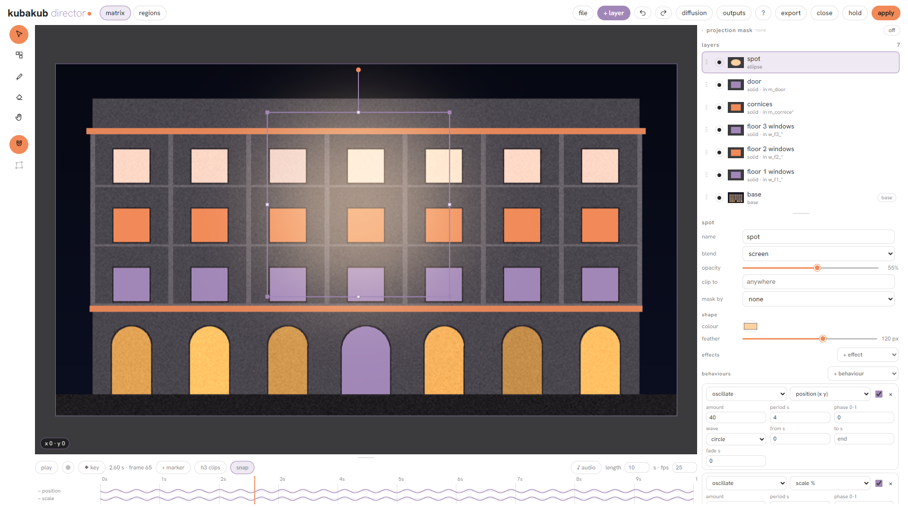
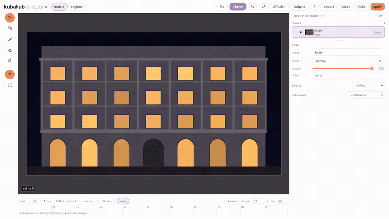
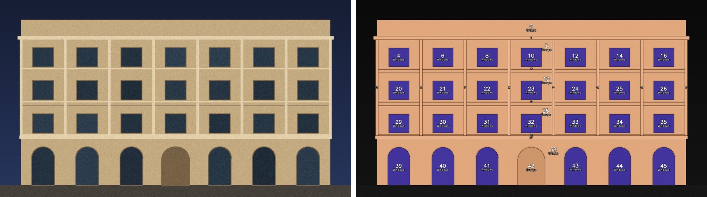
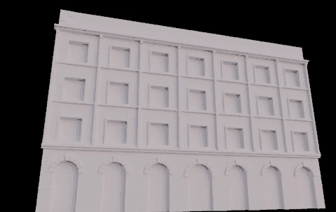
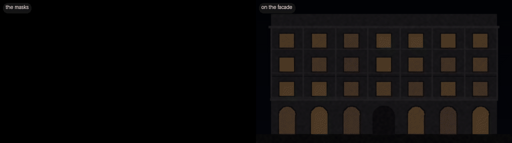
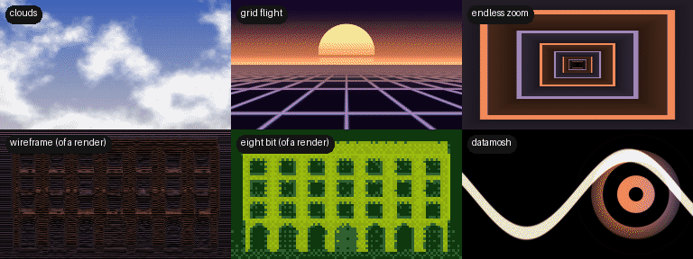
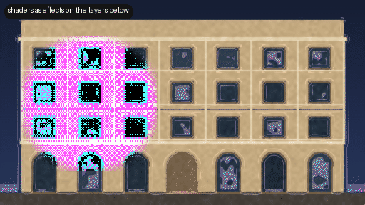

# kubakub nodes

**Projection mapping inside ComfyUI.** Tools to turn a building facade into a show: split it into its parts,
give every part its own material and its own prompt, move it with curves and sound, compose it in a timeline
window, and export the result for the projector.



Layers clipped to the windows of the sample facade, moved by behaviours on the timeline (starter 03 with the
regions of starter 01 connected):



## What's new

**0.7.0**, the show on one line:
- **kubakub timeline:** a tab of the bottom panel that holds the whole show. Every director is a block on it;
  rendered clips, pictures and sounds go around and over them, cut, trimmed, sped up and keyed (opacity, position,
  size), with a preview that plays it with sound. *kubakub timeline render* turns it into frames and sound for the
  projector. [docs/master.md](docs/master.md)
- **Two facade apps for App Mode:** 09 takes a facade and its masks, paints every region with Flux 2 Klein and moves
  the chosen ones with LTX; 10 adds two director scenes and puts it all on the timeline as one video.
  [docs/facade_show_app.md](docs/facade_show_app.md)
- **kubakub sample facade** takes your own matrix and mask folder.

Everything that changed, version by version: [CHANGELOG.md](CHANGELOG.md). Updates arrive through ComfyUI Manager
(*Update*) or `git pull`; a problem or a wish: [open an issue](https://github.com/kubakubkub/ComfyUI_KubaNodes/issues).

## How the parts fit together

Three levels, like a film set:

```
 kubakub timeline   the show: always there in the bottom panel; directors, rendered clips, pictures and sounds
        ▲           on tracks; timeline render → export for the projector
 kubakub director   a scene: one window per director with layers, lights, keys, behaviours and sound
        ▲
 the nodes          the instruments that make material for a scene: regions, region sampler (Flux Klein),
                    region video sampler (LTX / H3), shader, sound, tracker, pointclouder, 3D scene, finishing
```

A node is never on its own: its picture or clip goes into a director (as the facade, a layer or a video layer), and
every director is a block on the timeline. You can start at any level: **09 facade show** is the shortest way from a
facade to a moving picture, **03** opens a director, the timeline is the bottom panel tab *kubakub timeline*
([docs/master.md](docs/master.md)).

The nodes answer five questions, and each one has one place where you answer it.

**Where? Regions.** The facade split into every window, door, cornice and floor, each with a name. From a colour
matrix, a folder of After Effects masks, an Illustrator file, a hand sketch, SAM 3, a cryptomatte or ID render, or
straight from a 3D file. Every other node works on these regions, and wherever you choose some of them the field
is called **which regions** and reads the same way (`W_F1_*`, `group:Windows`).

**What? A shader is the material.** *kubakub shader* draws moving pictures and masks on the graphics card, with no
AI model: 74 presets picked by their moving picture and adjusted with sliders and colours, or a shader pasted from
shadertoy.com. Connect your regions and it draws in them, each window with its own colour, pace or pattern. A
second shader node behind the first is a second layer. Its picture is then a material:
- for the eye, as it is, on the facade or as the fill of a shape in the director;
- for a model: one cable into the *region sampler* and Flux 2 Klein or Qwen Image paints along its forms;
- for video: the same cable into the *region video sampler* and LTX moves the windows as the shader moves.

**When? Curves and sound.** A value that runs over time is a curve drawn on the node: buttons for its type, drag
for its speed. *mask animate* runs a reveal, a band or rings across the building, *height animate* lets forms grow
out of the wall. *kubakub sound* holds your music and how it is heard (tempo, loudness, hits) and carries it on
one cable to every node that listens, so all of them step on the same beat.

**Who paints it? A prompt per region.** A short rule text gives each region, group or floor its own prompt and
settings. The *region sampler* diffuses them one by one and the facade around them stays pixel exact; *versions*
makes a numbered sheet of looks from one queue; LTX 2.5 and MiniMax H3 animate chosen regions while the building
stays still.

**How does it come together? The director.** A compositing window inside ComfyUI, made for facades: layers
(images, video, colour, shapes with shader fills, paint, light) that you move, mask and clip to parts of the
building, a timeline with keyframes, behaviours, markers and sound, and export as stills, video or ProRes. Any
layer can be re-diffused from inside the window.

Around these:
- **3D.** *scene render* reads a `.fbx` / `.blend` / `.glb` with Blender and renders the projector's view as clay,
  depth and ID passes; every stone, window and column becomes a region by itself. *projector* places a projector
  in metres from the wall, several projectors get their blend masks. Audience spots and a walk are placed on a
  map on the node for the previz, and the model's pieces can be pushed, tilted and turned by waves and beats.
- **Finishing.** Colour match, deflicker, retime, burn in, delivery export; even brightness on the real building.



The stones of the sample model pushed out by a band that runs across the facade (starter 08, no AI model):



Masks that move: *mask field* turns the windows into a grey ramp, *mask animate* runs bands of light along it
(workflow mask_animate, no AI model):



*kubakub shader* draws moving pictures on the graphics card: 74 presets in eight types, picked by their moving
picture and adjusted with sliders and colour swatches, or a shader pasted from shadertoy.com (workflow shader, no AI
model):



In the director a shader is the fill of a shape, and a preset that works on a picture becomes an effect on
everything under it:



## Install

With **ComfyUI Manager**: search for *kubakub nodes*, install, restart. The pack is in the Comfy Registry as
`comfyui-kubanodes` (publisher `kubakub`), so `comfy node install comfyui-kubanodes` works too. Or by hand:

```bash
cd ComfyUI/custom_nodes
git clone https://github.com/kubakubkub/ComfyUI_KubaNodes
python -m pip install -r ComfyUI_KubaNodes/requirements.txt     # the portable build: python_embeded\python.exe -m pip ...
```

The only package this adds is OpenCV, and only if you don't have it yet. Everything else comes with ComfyUI
(0.37.0 or newer). For the 3D nodes and light layers, install [Blender 4.x](https://www.blender.org/download/lts/4-5/)
(found by itself). To take the scene open in **Blender or Houdini** live into scene render, install their
add-ons from this pack once: [docs/live-link.md](docs/live-link.md).

**Models:** the example workflows need them, the nodes don't: see [docs/MODELS.md](docs/MODELS.md). Any variant of a
model works (bf16, fp8, int8, NVFP4, GGUF ...): pick your file in the loader when a workflow names another one.

## Quick start

1. Install, restart ComfyUI.
2. **Workflow → Browse templates → ComfyUI_KubaNodes → 01 regions in 30 seconds**, Queue. No models, no files:
   the **kubakub sample facade** node draws a facade to try everything on.
3. **03** opens the director window on that facade: add a layer, clip it to a floor, give it a behaviour, press
   play. Still no models.
4. Still no models: **shader** (pick a preset by its picture, adjust it), **region_materials** (two shaders
   stacked in the windows of the facade), **sound** (one sound for a shader and a mask), **mask_animate**.
5. Then **02** (a prompt per region, Klein 4B), **region_materials_klein** (Klein paints from a shader), **04**
   (LTX animates the windows), **05** (a hand sketch rendered region by region), **06** (finishing a clip: colour
   match, deflicker, retime, burn in).
6. 3D, with Blender installed and still no files: **07** (a sample building in metres, rendered from a projector
   you place: regions from the model, real distances, previz from the audience) and **08** (its stones moved by a
   wave). **projector_blend**: two projectors and their blend masks. Your own model: paste its path into `file` of
   scene render.
7. With your own 3D: **clay_to_final** (scene file → clay → regions → Klein → seam pass → even light),
   **scene3d_to_regions**, **render_passes_to_final** (your own render and its mask passes: only the masked parts
   are repainted) and **regions_from_cryptomatte** (a cryptomatte EXR from any renderer). **versions**
   makes many versions of the facade from one queue: a numbered contact sheet of drafts, then your picks at full size.

## What each part needs

Most of the pack runs on a plain ComfyUI. Add the rest when you get there:

- **Nothing extra:** regions, the region plan, masks, shader, sound, sketch, post and the director with still
  layers. Workflows 01 and 03, mask_animate, shader, shader_mix, region_materials and sound.
- **Image models** (Klein 4B is the smallest, see [docs/MODELS.md](docs/MODELS.md)): region sampler, seam pass,
  versions, frame in frame, sketch to render. Workflows 02, 05 and region_materials_klein.
- **Video models** (any LTX 2.x or MiniMax H3: dev or distilled, fl2va or ref2va, fp8 / nvfp4 / int8 / GGUF, with or without a speed LoRA; tested on a 12 GB GPU): region video sampler, motion guide, keyframe clips. Plug in the model you have: the nodes see which one it is and sample it the way it needs. Workflows 04 and motion_guide.
- **Blender 4.x:** everything under 3d / scene and 3d / pieces, and light layers in the director. Workflows 07 and
  08 use the sample model; your own file needs no camera (kubakub projector). Workflow clay_to_final.
- **Your own files**, for the nodes that read them: an Illustrator file, render passes, ID renders or a cryptomatte
  EXR, a video clip for 06.

**An empty file field is the sample.** Every node that reads a file or folder of yours (scene render, render
passes, regions from id renders, regions from cryptomatte, regions from illustrator, the mask folder of regions
from matrix / masks) runs on a built-in sample when the field is empty, and says so in its report. Pasting a path
is the only step to your own file. So the example workflows run without any file of yours. Packages, Blender and ffmpeg are listed under [Requirements](#requirements).

## Node groups

The menu is split into **2d** (images, masks, video) and **3d** (anything that needs a 3D file or render passes).

| group | nodes |
|---|---|
| **project** | project settings (matrix size, fps, name, audience: link them into the other nodes), sample facade, sample model (the same facade as a 3D file) |
| **2d / regions** | regions from matrix / masks (colours, line drawing, After Effects mask folders), regions from masks, regions from sam3, regions from illustrator (.ai / .pdf layers), regions to mask (shows the chosen regions lit up, passes the choice on as text), regions to svg / pdf / dxf; canvas plan / to work / restore. Every `which regions` field has a **pick regions** button: the groups, floors and sections your regions hold, as a list to click |
| **2d / masks** | mask field (regions as a grey ramp: distance from the edge, a direction, from a point, one step per region, noise; the direction can be drawn as an arrow on the node), mask animate (a mask per frame: reveal, band, rings along a field, or move, rotate, scale, strobe, with a trail; on a ramp, sine, saw, square, random, noise or a sound; the curve is drawn on the node) |
| **2d / shader** | shader (moving pictures and masks drawn on the graphics card: 74 presets picked by their picture: light that knows your regions (each its own colour, pace or pattern), contours, wire mesh and point cloud of the building, raymarched 3D scenes with a depth output (melting forms, a colonnade, the facade as a relief, regions extruded, light in fog), endless travel, 8 bit and pixels, VHS tape and composite video, slit scan and datamosh, clouds, fire, a mapping grid; or paste a shader from shadertoy.com; follows a loop, a field, a mask, your regions and the sound; its picture is the material the region samplers paint from), shader mix (two kubakub shaders on its inputs a and b and one mix value: A cuts B in, A bends B, or a fade; on a curve or with the sound) |
| **2d / sketch** | scan to line (a phone photo of a drawing, straightened and cleaned), regions from sketch (closed shapes, coloured dots as names), line overlay (your line back on the render) |
| **2d / generate** | region prompt (a prompt for chosen regions from fields: pick the regions from a list, write the prompt, set strategy and denoise; chain several), region plan (the same as written rules, with every setting), region sampler (Klein, Qwen Image 2.1; paints from a shader's picture on `material`, changes as much as a mask on `change` allows), seam pass, versions (a sheet of looks, ideas per region, prompt rotation, LoRAs and style images: fast numbered drafts, then the picks at full size), frame in frame (rooms and worlds behind windows) |
| **2d / director** | kubakub director (the window), director sequence (every frame, sound), director diffuse |
| **2d / motion** | pointclouder (a picture or a video lifted into up to two million points by any depth node, played live on the node: drag to look around, set the camera move from the view, pick a move (push in, orbit, handheld ...) or record your own; glow / ink / solid, drift, breathe, wind, curl, fine trails, a scan through the depth, arrows you draw that push the points; follows the sound; pictures morph into each other; tracked things sit in the cloud at their depth; .ply out), tracker (what moves in a video, followed with ids: motion, a colour, lights, people and things with body points or outlines, anything named in words, body / hands / face points, a clicked motif, exact outlines; several at once, all from files on your disk; with a depth node every thing gets its depth; with a sound the tracks carry its loudness and beats), track draw (the tracks as a diagram, played live on the node: boxes, outlines, circles, labels and state words, lines between them in nine ways, reveal / pixels inside, depth layers, depth contours, far = earlier, a stamp trail of their own pixels, each part in its own blend mode, marks that pulse and lines that flash with the sound; the tracks also steer kubakub shader and the director's 'follow'), sound (your sound and how it is heard, set once and carried on one cable to every node that listens; draws the loudness, the beats and the hits), region video sampler (LTX or H3; a shader clip on `material` moves the regions), motion guide (LTX or H3: a rough moving clip from the director, a shader or a previz becomes a finished video that keeps its motion), keyframe clips (H3 or LTX, video with sound), height animate (a height map or any depth map grows out of the wall: all together, peaks first, in layers or along a field, on a curve or with the sound; also as a lit relief), sound mask swap (layers trade their masks on beats, on low / high hits, or on a control signal), trim to exact duration (audio clips of a constant length for LTX AV) |
| **2d / post** | align to source (an edited picture back onto the picture it was made from, to the pixel), colour match (to a reference picture or a .cube look, saved as .cube too), deflicker, retime (optical flow), burn in, export video / frames |
| **3d / scene** | scene render (Blender: clay, depth, ID passes), projector (where it stands: metres from the wall, height, throw ratio, lens shift or tilt), projector blend (soft-edge masks for several projectors), scene relight (Cycles), scene measure, scene preview and walkthrough (previz from the audience; the spots and the walk are placed on a map on the node), scene surroundings (the street around the building, from a place on the map or your own model), align 3d model (a model from image-to-3D, moved, turned and scaled onto the real one; written as .glb or .obj with textures), form height (how far that model stands out of the real wall, as a height map in the projection view), brightness compensation |
| **3d / pieces** | scene pieces, pieces falloff, pieces transform, pieces render: the model's parts (or whole regions) moved like MOPS in Houdini (a wave, a pulse, a stagger, noise or the beats of the director's timeline push, tilt, turn and scale stones, windows and cornices), rendered in Cycles as clay or with the matrix projected on them, from the projector or from the audience |
| **3d / from renders** | render passes (a folder of your passes: picture, depth, normals, every other pass as a mask), regions from cryptomatte (every object by its name from the 3D scene), regions from id renders (Houdini, Blender, any ID pass) |
| **3d / fabricate** | relief panels in millimetres (mould prep with anti perch, safety check, mass, export as STL panel or OBJ prow), mesh to relief field, save GLB |
| **lab** | experiments: mosaic illusion, onnx style transfer, frame guide (old) |
| **utils** | crop (drawn on the picture as in Photoshop: ratio, size and canvas past the edge on pills, nothing typed), uncrop (the edited crop back into the picture, soft edge), compare (two pictures or videos on the same frame: swipe, side by side, difference, blink, onion, a big window with zoom), load images from a folder, timecode filename prefix (clip start in seconds -> `name_mm-ss-ff`) |

### Show only what you use

Copy `kubakub.ini.example` to `kubakub.ini` (same folder) and switch groups off, then restart ComfyUI:

```ini
[menu]
3d = off            # everything under kubakub/3d
lab = off
2d/motion = off     # no LTX / H3
```

Switched-off nodes are not loaded at all, so workflows that use them show them as missing until you switch them on
again. The console says what is hidden: `[Kub] kubakub.ini: 3d, lab off (21 nodes hidden)`.

Search the node menu for `kubakub`, or for words like *projection mapping*, *facade*, *sam*, *ltx*, *h3*, *blender*.

## Speed and caches

Unchanged work is never done twice, also across queues and (for the 3D scene) across ComfyUI restarts. The sizes
are settings in `kubakub.ini` (section `[settings]`, see `kubakub.ini.example`); the defaults suit a 12 GB GPU:

| what | cache | setting |
|---|---|---|
| region sampler | every region's result (keyed on its pixels, prompt, seed, settings, model) and every prompt encoding: one changed prompt re-samples one region | `region_cache_mb = 4096`, `cond_cache_mb = 2048` (0 = off) |
| director sequence | the frames: moving the playhead or changing window-only settings reuses them; an identical export is not written twice | `director_seq_cache = 2` (results, 0 = off) |
| ltx region video / h3 clips | every clip; H3's enhanced prompt separately (steps or LoRA changes do not re-run the enhancer); models load once for all clips, and not at all while the director holds or nothing is animated | - |
| scene render / relight / walkthrough | ID passes, every relit frame, every walkthrough view, on disk in the user folder (`kubakub_cache`), least recently used first above the cap | `cache_folder =` (empty = user/kubakub_cache), `cache_gb = 20` |
| Blender | one worker process stays loaded between jobs | `blender_idle = 600` (seconds), `blender_worker = off` to start it for every job |

## Requirements

**Tested with:** ComfyUI 0.38.2, torch 2.10 cu130, Python 3.12, Blender 4.5, Windows 11, RTX 5070 Ti 12 GB.
Other systems are untested.

| needs | for | without it |
|---|---|---|
| ComfyUI **0.37.0** or newer | every node (V3 node API, advanced inputs; core SAM3, background removal, H3 guide) | modules fail to load (each one alone; the console says which) |
| torch, numpy, scipy, Pillow | everything | come with ComfyUI; no torch / CUDA version of its own |
| **OpenCV** (`opencv-python-headless`, in requirements.txt) | almost everything | the pack does not load; keep an OpenCV build you already have |
| shapely | regions to vector: outlines | that feature only |
| scikit-image | regions to vector: centerlines | that feature only |
| PyMuPDF | regions from illustrator, vector PDF | that feature only |
| imageio | EXR ID maps in regions from id maps | PNG ID maps still work |
| trimesh | mesh to field | that node only |
| onnxruntime | onnx style transfer | that node only |
| **Blender 4.x** (found in Program Files or on PATH; else `blender = ...` in kubakub.ini or the blender_path input) | scene render, light layers, relight | the 3D scene nodes and light layers |
| **ffmpeg** (imageio-ffmpeg or on PATH) | video layers, director sequence export, kubakub export | video in the director and exports |

At startup the console prints `[Kub] N nodes from M modules` and, only when something is missing, one line per
problem (`kub_env.py`), e.g. `[Kub] not installed (only these features are off): regions to vector (outlines) -> pip
install shapely`. The models used by the example workflows (Klein, Qwen Image 2.1, LTX 2.5, MiniMax H3) are listed in
each workflow's read-me note; the nodes themselves need none.

## Documentation

One page per menu group, with every input, the rule syntax, speeds and tests:

| page | what is in it |
|---|---|
| [regions](docs/regions.md) | regions from a matrix, a line drawing, mask folders, any masks, SAM 3, Illustrator; regions to SVG / PDF / DXF; canvas plan / to work / restore |
| [masks](docs/masks.md) | mask field, mask animate: effects, curves, things to try |
| [shader](docs/shader.md) | shader: the 74 presets by type, your regions in a shader, mixing two shaders, adjusting one with sliders and colours and saving your own, pasting a shader from shadertoy.com step by step (also with Buffer tabs), 3D scenes (raymarching) and the depth output, the names a shader can use, speed |
| [sketch](docs/sketch.md) | scan to line, regions from sketch, line overlay |
| [generate](docs/generate.md) | region prompt (fields, no rule text), region plan (the rule text), region sampler (Klein, Qwen Image 2.1 and its LoRAs), a shader as the material of your regions, seam pass, frame in frame |
| [director](docs/director.md) | kubakub sound; the director window: layers, timeline, sound, LTX and H3 clips, diffuse, crop and compare, light layers, video mapping, behaviours, export |
| [timeline](docs/master.md) | the master timeline in the bottom panel: directors and rendered clips one after another, project length / fps / size, cut, trim, speed, keys, preview, and the timeline render node |
| [post](docs/post.md) | colour match (a reference picture or a .cube), deflicker, retime, burn in |
| [utils](docs/utils.md) | crop by drawing, uncrop, compare pictures and videos |
| [tracking](docs/tracking.md) | kubakub tracker (every finder, depth, try this frame) and track draw (presets, marks, lines, inside, depth, stamp trail, blend modes, state words); tracks in the shader and the director |
| [pointclouder](docs/pointcloud.md) | kubakub pointclouder: inputs, the camera move, moves and recording, the look, the motion, trails, drawn forces, the sound, tracked things in 3D, .ply |
| [3d scene](docs/scene3d.md) | scene render and its ID passes, architecture passes, scene measure, preview, walkthrough, brightness compensation, moving pieces |
| [live link](docs/live-link.md) | installing the Blender add-on and the Houdini package (in `tools/`) that send the open scene to scene render; checking, updating, removing, troubleshooting |
| [from renders](docs/from-renders.md) | regions from ID renders (Houdini, Blender, any ID pass), regions from cryptomatte |
| [fabricate](docs/fabricate.md) | relief panels in millimetres, safety check, STL / OBJ |
| [models](docs/MODELS.md) | the models the example workflows use, and where they go |

Every group has a model-free test in `tests/`, e.g. `python_embeded\python.exe ComfyUI\custom_nodes\ComfyUI_KubaNodes\tests\test_plan.py`.

## Credits

- Crop sampling with the crop latent as reference, and the two-band blend idea:
  GianlucaMancuso/ComfyUI-TiledUpscale (github.com/GianlucaMancuso/ComfyUI-TiledUpscale).
- Clamped mean/std colour match, consistent noise idea: Gavr728/ComfyUI_KleinTiledUpscaler.
- Differential diffusion step (`kubakub/seams.py`): adapted from ComfyUI core
  comfy_extras/nodes_differential_diffusion.py, originally github.com/exx8/differential-diffusion. The change map
  of a region's material (`kubakub/adapters.py`, change_by_steps) uses the same idea, counted in steps.
- Pixel drift of whole-picture edits as a thing to correct (`kubakub/align.py`; the method is our own):
  github.com/Mozer/ComfyUI-PixelDriftFix (Mozer).
- Pruna 8-step sigmas (`kubakub/schedules.py`): model card of
  huggingface.co/PrunaAI/Pruna-Qwen-Image-2.1 (PrunaAI).
- Flux 2 schedule (`kubakub/adapters.py`): copied from ComfyUI core
  comfy_extras/nodes_flux.py (github.com/comfyanonymous/ComfyUI, Comfy Org).
- Video layers (`kubakub/director/media.py`): stream parsing, the two-step seek, the raw frame pipe and the
  audio read adapted from ComfyUI-VideoHelperSuite (github.com/Kosinkadink/ComfyUI-VideoHelperSuite,
  Kosinkadink / AustinMroz).
- A sound as a held audio latent in the region video sampler (`nodes/motion/nodes_video.py`): the wiring of
  RuneXX's custom-audio LTX workflows (huggingface.co/RuneXX/LTX-2.3-Workflows).
- The buildings of kubakub scene surroundings: map data (c) OpenStreetMap contributors, under the Open Database
  License (openstreetmap.org/copyright), fetched through the Overpass API (overpass-api.de). Its real ground:
  the Mapzen / Tilezen terrain tiles on AWS Open Data (SRTM, EU-DEM and other open sources; attribution list at
  github.com/tilezen/joerd/blob/master/docs/attribution.md).
- The shader presets *vhs tape* and *composite video* (`kubakub/shaders/`): the steps and their order follow the
  signal chain of ntsc-rs (github.com/valadaptive/ntsc-rs, valadaptive), found through olegchomp's TouchDesigner
  version (github.com/olegchomp/ntsc-td). *scan modulation*: the idea of olegchomp's td-modulation
  (github.com/olegchomp/td-rnd). All three are written new as single shader passes.
- The shader presets of the type *grade and lens* (`kubakub/shaders/60_*` - `71_*`): which effects belong in such
  a set follows GIPS by Martin J. Fiedler (github.com/kajott/GIPS), found through theRealAi's ComfyUI-GLSL
  (github.com/theRealAi/ComfyUI-GLSL). All are written new for this pack.
- A colour as a control of a shader, and the idea of a picker for it: comfyui_glslnodes by Patricio Gonzalez Vivo
  (github.com/patriciogonzalezvivo/comfyui_glslnodes). Written new (`kubakub/shadertoy.py`, `web/kubakub_shader.js`).
- The distance functions and smooth joins a kubakub shader can use for a 3D scene (`kubakub/shadertoy.py`, SDF):
  Inigo Quilez, iquilezles.org/articles/distfunctions.
- MKL colour transfer: Pitie & Kokaram 2007, as in the color-matcher library
  (github.com/hahnec/color-matcher); reimplemented in torch in `kubakub/ops.py`.

## License

GPL-3.0 (see `LICENSE`), the same as ComfyUI. Free to use, change and share, also in paid work; a changed version
that is published must stay GPL-3.0 with its source. The license covers this code only: images and videos you make
with the nodes are yours. The Hanken Grotesk font in `web/fonts` keeps its own SIL Open Font License.
